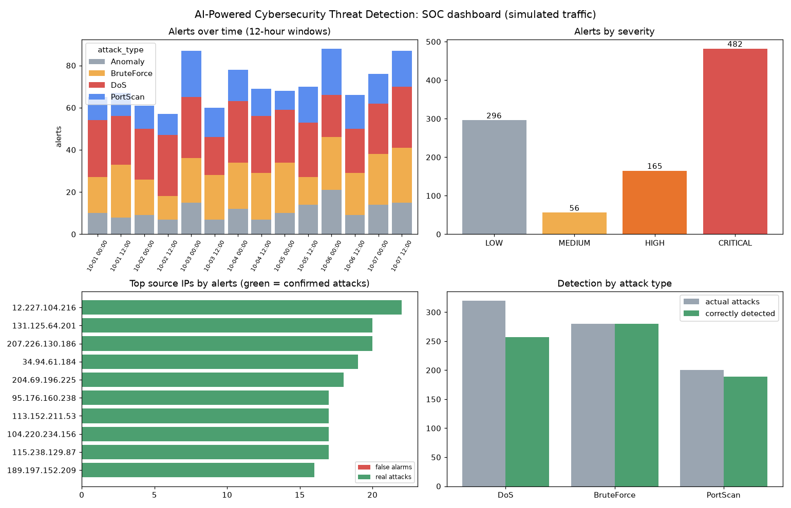
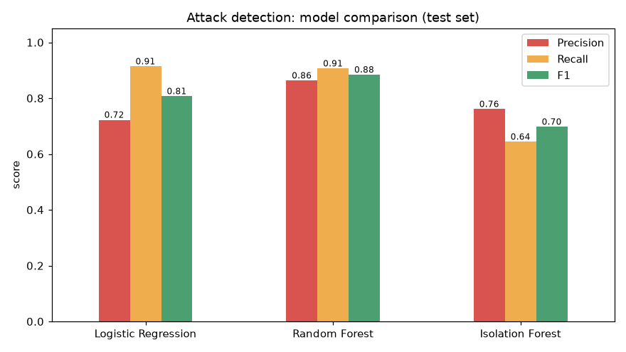
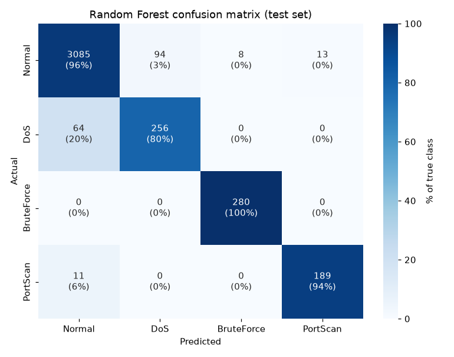
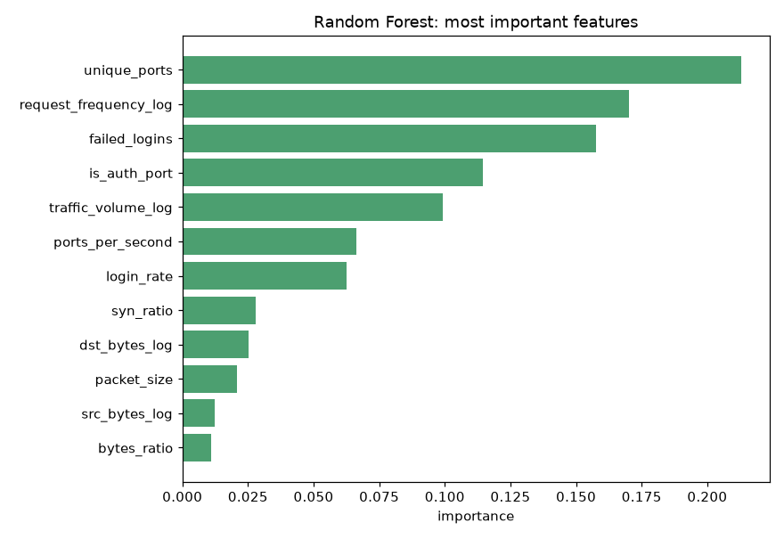
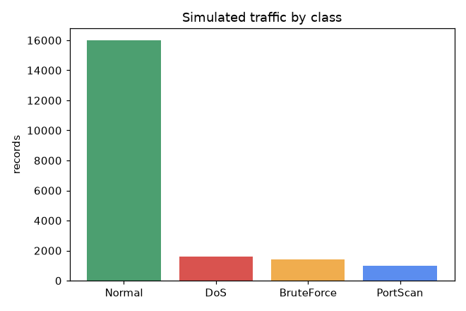
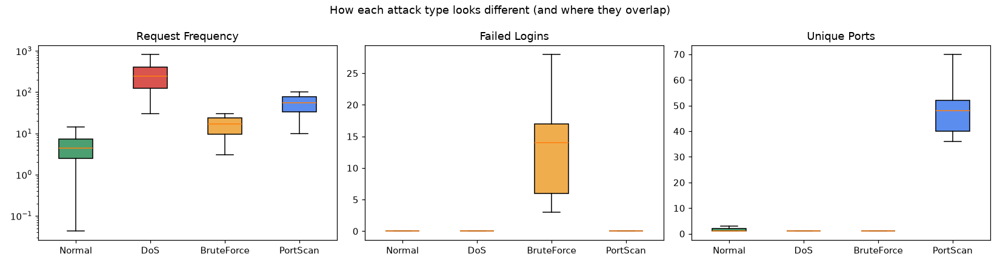
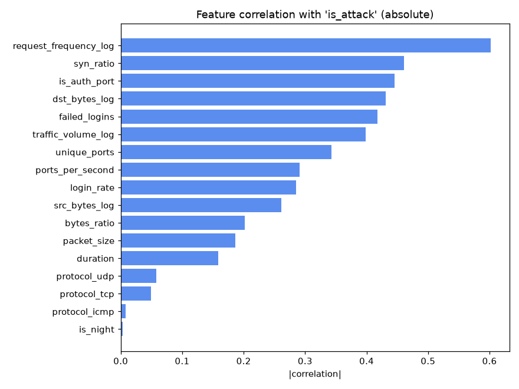
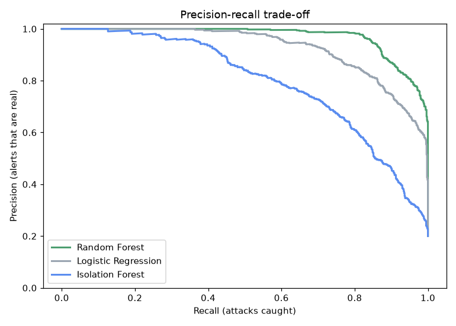

# AI-Powered Cybersecurity Threat Detection System

A machine-learning system that detects network attacks (DoS floods, brute-force logins, port scans) in simulated traffic, raises severity-ranked alerts with plain-English explanations, and serves predictions through a small API.



## Overview

Security teams cannot read every log line, so they use models that flag suspicious traffic and rank it by severity. This project builds that pipeline end to end on simulated network traffic:

**Traffic simulation → cleaning → feature engineering → detection (Random Forest + Isolation Forest) → alert engine → dashboard and API**

## Problem statement

Static rules miss new or slow attacks, and analysts drown in false alarms. This project shows how supervised classification and unsupervised anomaly detection can be combined, how to measure them honestly (precision and recall, not just accuracy), and how to turn detections into alerts an analyst can act on.

## Industry relevance

Intrusion detection, anomaly detection and alert triage are core parts of security monitoring at banks, IT services companies and security vendors. This project is a **learning prototype of those ideas on simulated data**, not a production system. It covers network-level attacks only (not phishing emails or malware files).

## Features

- Traffic simulator with normal users plus DoS, brute-force and port-scan attacks, including **stealthy attacks that blend in with normal traffic**
- Cleaning and 17 engineered features (log transforms, ports per second, login rate, auth-port flag, protocol encoding)
- **Leak-free** train/test split: the data is split first, then the scaler is fitted on the training set only
- Three models: Logistic Regression baseline, Random Forest (attack type), Isolation Forest (unsupervised, trained on normal traffic only)
- Alert engine with severity levels and readable reasons
- Evaluation: confusion matrix, per-attack precision and recall, threshold trade-off, feature importance
- Flask API for single-record predictions, and automated tests

## Tech stack

Python 3.11, pandas, NumPy, scikit-learn, Matplotlib, Seaborn, Flask, pytest

## Architecture

```
 Traffic simulator (Normal, DoS, BruteForce, PortScan)
            |
            v
   Raw logs (CSV) --> Cleaning --> Feature engineering --> Train/test split --> Scaler (train only)
                                        |
                  +---------------------+---------------------+
                  v                                           v
        Random Forest (known attack types)         Isolation Forest (unusual traffic)
                  |                                           |
                  +---------------------+---------------------+
                                        v
                    Alert engine (type, score, severity, reason)
                                        |
                       +----------------+----------------+
                       v                                 v
              Dashboard + alert log (CSV)        Prediction API (Flask)
```

## Dataset

The data is **simulated** (`src/simulator.py`), because no real corporate network data is available. It contains 20,000 traffic records, one row per source IP per time window:

| Class | Share | Typical pattern |
|---|---|---|
| Normal | 80% | moderate request rate, few failed logins, 1 to 2 ports |
| DoS | 8% | very high request rate, many half-open (SYN) connections |
| BruteForce | 7% | many failed logins on SSH, RDP or FTP ports |
| PortScan | 5% | many different ports probed, tiny packets |

Between 20% and 45% of each attack type is "stealthy" and looks close to normal traffic, and some normal users look suspicious (busy downloaders, forgotten passwords). **Simulated data is easier than real traffic**, so absolute scores here should not be compared with real-world systems. The code is structured so real data (for example NSL-KDD or CICIDS) can be added later.

## Installation

```bash
git clone https://github.com/yaswitha-kamakshi/AI-Cybersecurity-Threat-Detection.git
cd AI-Cybersecurity-Threat-Detection
python -m venv venv
venv\Scripts\activate        # Windows (macOS/Linux: source venv/bin/activate)
pip install -r requirements.txt
```

Tested with Python 3.11.

## How to run

```bash
python preview_data.py       # generate data/traffic.csv and preview it
python preprocess_demo.py    # cleaning, features, split, leakage check
python train.py              # train the three models and save them to models/
python evaluate_models.py    # confusion matrix, per-class metrics, threshold analysis
python run_detection.py      # replay unseen traffic, raise alerts, build the dashboard
python app.py                # start the API at http://127.0.0.1:5000  (then: python test_api.py)
python -m pytest -q tests    # run the tests
```

## Results

All numbers are on a held-out test set of 4,000 records (fixed random seeds, reproducible).

### Attack vs normal

| Model | Accuracy | Precision | Recall | F1 |
|---|---|---|---|---|
| Logistic Regression (baseline) | 0.912 | 0.722 | 0.914 | 0.807 |
| **Random Forest** | **0.952** | **0.863** | **0.906** | **0.884** |
| Isolation Forest (no labels) | 0.888 | 0.761 | 0.644 | 0.697 |

Random Forest attack-type macro F1: **0.915**. Accuracy alone is misleading here because 80% of the traffic is normal.



### Per attack type (Random Forest)

| Attack | Recall | Note |
|---|---|---|
| BruteForce | 100% | strongest signal (failed logins on auth ports) |
| PortScan | about 94% | |
| DoS | about 80% | weakest: low-rate floods look like busy normal users |



### Alert threshold trade-off

| Threshold | Precision | Recall |
|---|---|---|
| 0.2 | 0.72 | 0.99 |
| 0.5 | 0.86| 0.91 |
| 0.9 | 0.99 | 0.76 |

A lower threshold catches more attacks but creates more false alarms. Where to set it depends on the cost of a missed attack.

### Alert pipeline (unseen traffic replayed in time order)

| Metric | Result |
|---|---|
| Records analysed | 4,000 |
| Alerts raised | 999 |
| Real attacks caught by the classifier | 90.8% (726 of 800) |
| False alarms on normal traffic | 3.6% |
| **HIGH/CRITICAL alerts that were real attacks** | **98.3% (636 of 647)** |

Severity comes from model confidence and is raised one level when both detectors agree, so the top of the alert queue is highly reliable.



## API example

```bash
curl -X POST http://127.0.0.1:5000/predict -H "Content-Type: application/json" -d "{\"failed_logins\": 15, \"dst_port\": 22}"
```

```json
{"threat_detected": true, "attack_type": "BruteForce", "attack_score": 1.0, "severity": "CRITICAL",
 "reason": "15 failed logins against port 22: possible password guessing"}
```

## Screenshots

| Class distribution | Feature profiles |
|---|---|
|  |  |

| Feature correlation | Precision-recall |
|---|---|
|  |  |

## Limitations

- **Simulated data.** Results are not comparable with real-world systems, and the models have not been tested on real traffic.
- **Slow DoS is the weak spot.** About 20% of DoS windows are missed and some busy normal users are flagged. Real-world fixes include longer time windows and per-source history.
- **The Isolation Forest adds little here.** Only 6 of its 158 extra alerts were real attacks the classifier missed. It would matter more with genuinely new attack types, which this simulation does not contain.
- Each row is one independent window, so there is no sequence modelling across time.
- Network attacks only: no phishing or malware detection.

## Future improvements

- Train and evaluate on a real dataset (NSL-KDD or CICIDS2017)
- Add per-source history features and sliding time windows
- Add drift monitoring and scheduled retraining
- Explain predictions with SHAP
- Containerize the API with Docker and add a live dashboard (Streamlit)

## Learning outcomes

Simulating realistic data, preventing data leakage, handling class imbalance, comparing supervised and unsupervised detectors, evaluating with precision, recall and confusion matrices, tuning alert thresholds, turning predictions into explainable alerts, and serving a model through an API with tests.

## Author

**Yaswitha Kamakshi**
GitHub: [@yaswitha-kamakshi](https://github.com/yaswitha-kamakshi) | LinkedIn: www.linkedin.com/in/yaswitha-kamakshi-292b5242b